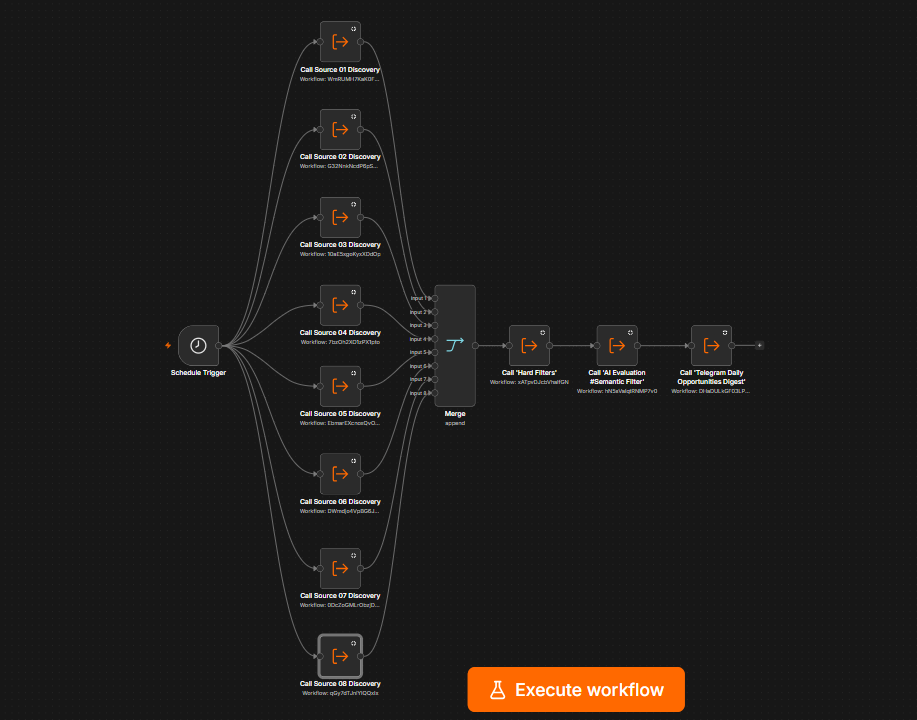
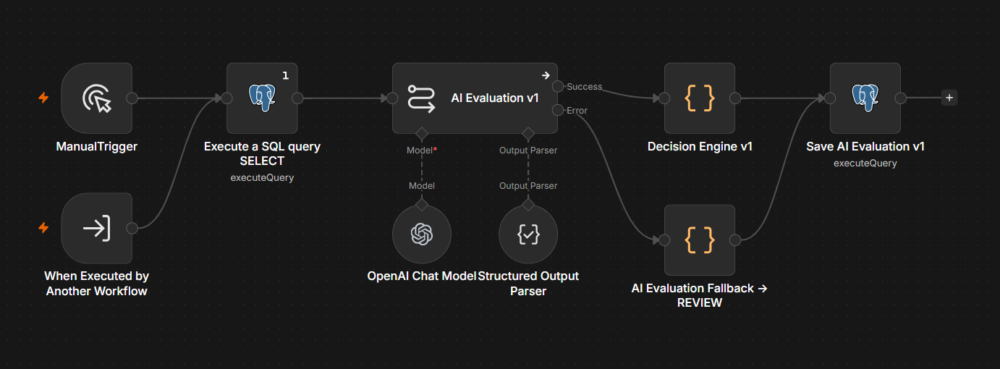
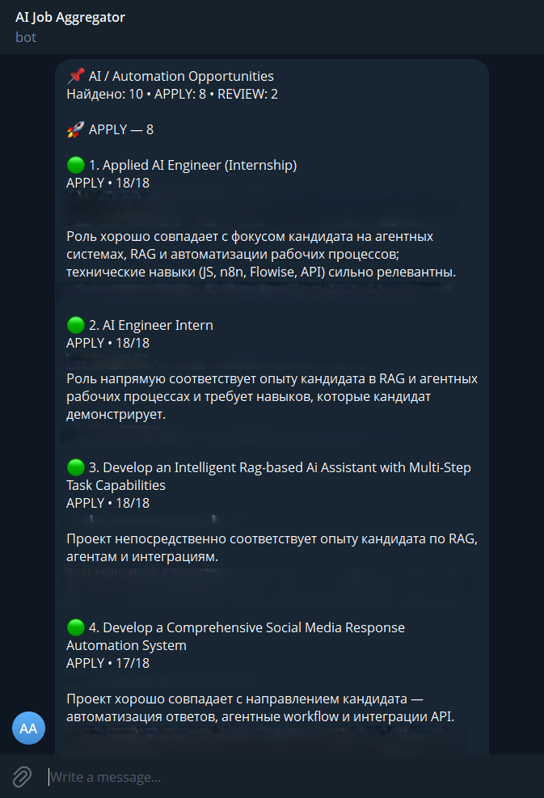
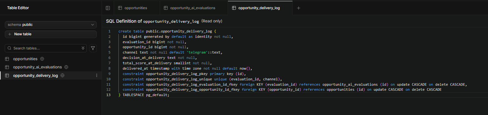

# AI-Powered Freelance Opportunity Aggregator

A multi-source opportunity intelligence system built with n8n and PostgreSQL to collect, normalize, evaluate, and prioritize freelance and remote job opportunities through a human-in-the-loop decision workflow.


## Overview

The system integrates 8 different sources using REST APIs, RSS feeds, GraphQL, HTML extraction, and email-based ingestion. Opportunities are normalized into a unified data model, filtered through deterministic hard rules, evaluated with an LLM, and classified as APPLY, REVIEW, or SKIP using a separate decision layer.

The project consists of 14 coordinated n8n workflows: 8 source-specific discovery workflows, 4 core processing workflows, and 2 operational support workflows for database maintenance and decision-quality auditing. The main opportunity pipeline runs on a daily schedule, while maintenance and quality-control workflows run independently on a weekly schedule. The highest-priority opportunities are delivered through a Telegram digest, with delivery logging and duplicate prevention to avoid repeated recommendations.

## Problem

Freelance and remote job opportunities are distributed across many platforms, each with different search interfaces, data formats, notification systems, and access methods.

Manually checking multiple sources every day is time-consuming and makes it easy to miss relevant opportunities. Traditional job alerts also provide limited filtering and usually do not account for a candidate's actual skills, project preferences, technical background, or geographic constraints.

The goal of this project was to build a single automated pipeline that could:

- collect opportunities from heterogeneous sources;
- normalize them into a consistent data structure;
- remove duplicates and obvious mismatches;
- evaluate remaining opportunities against a defined candidate profile;
- prioritize the most relevant opportunities;
- deliver a concise daily digest without repeatedly showing the same listings.

The system was originally built to solve this problem in my own freelance search, making me its first real user as well as its developer.

## How to Explore This Project

If you are reviewing the project, a useful path is:

1. Start with **Architecture** to understand the overall system design.
2. Review **Data Acquisition & Normalization Strategy** to see how heterogeneous inputs are converted into a common data model.
3. Continue with **Processing Pipeline** for the deterministic filtering, semantic evaluation, and decision logic.
4. See **Data Storage & State Management** for persistence, versioning, and delivery-state handling.
5. Review **Testing & Validation** for examples of how the system was calibrated and verified.
6. Explore the sanitized workflow exports and diagrams for implementation-level examples.

Production-specific credentials, personal configuration, private integration details, and environment-specific values are intentionally excluded from the public repository.

## Project Planning & Requirements

Before implementation, the project was broken down into functional requirements, data-source constraints, processing stages, and delivery rules.

The initial planning phase defined several core requirements:

- aggregate opportunities from multiple freelance and remote-job sources;
- support different ingestion methods depending on what each platform exposes;
- normalize heterogeneous listings into a single opportunity schema;
- store normalized opportunity data and processing state in PostgreSQL;
- deduplicate opportunities across repeated discovery runs;
- separate obvious hard-fail filtering from semantic AI evaluation;
- classify opportunities as APPLY, REVIEW, or SKIP without automatically applying on the user's behalf;
- favor manual review over prematurely rejecting potentially relevant opportunities;
- deliver a limited, high-priority daily digest through Telegram;
- track delivered opportunities to prevent repeated recommendations;
- avoid sending every discovered opportunity directly to the LLM, use deterministic preprocessing and hard filtering first to reduce unnecessary AI calls and keep operating costs predictable.

Potential data sources were evaluated before integration. A source matrix was created to compare available access methods such as REST APIs, RSS feeds, HTML extraction, GraphQL, and email alerts, as well as reliability, authentication constraints, and expected data availability.

Based on this analysis, the system was divided into independent discovery workflows and shared processing layers, allowing each source integration to evolve without changing the core filtering, evaluation, storage, and delivery pipeline.

## Architecture

The system uses a modular, layered architecture that separates source-specific data collection from shared filtering, evaluation, storage, and delivery logic.

The project is composed of 14 coordinated n8n workflows: 8 source-specific discovery workflows, 4 core workflows responsible for orchestration, filtering, AI evaluation, and delivery, and 2 independent operational workflows for database housekeeping and decision-quality auditing.

Discovery workflows are isolated from one another at the orchestration layer. A failure in one source-specific workflow is surfaced as an error result without stopping the remaining discovery branches, allowing downstream filtering, evaluation, and delivery to continue using successfully persisted data from the available sources.

Operational maintenance is intentionally separated from the daily pipeline. Database housekeeping manages long-term data retention, while a weekly SKIP audit samples rejected opportunities for human review to detect potential false negatives.





The **Discovery Layer** isolates source-specific integrations from the rest of the system. Each source can use its own ingestion method while producing records that conform to the same normalized opportunity schema.

PostgreSQL acts as the system's central state layer. Discovery workflows upsert normalized opportunities into the database, while downstream workflows independently read and update filtering results, AI evaluations, decisions, and delivery state.

The **Merge** node in the Daily Orchestrator is primarily used as a synchronization barrier. Because discovery workflows already persist their results directly to PostgreSQL, downstream processing does not depend on passing all discovered records through a single in-memory workflow chain.

Core processing is separated into deterministic filtering, semantic evaluation, deterministic classification, and prioritized delivery.

This separation keeps source integrations modular, reduces unnecessary LLM calls, makes decisions easier to audit, and allows individual layers to evolve without rebuilding the entire pipeline.

### Daily Orchestrator

The production orchestrator coordinates eight source-specific discovery workflows before triggering the shared filtering, AI evaluation, and delivery pipeline.



*Sanitized production view. Source-specific workflow names and private configuration have been generalized for the public repository.*

## Data Acquisition & Normalization Strategy

The discovery layer was designed to work with heterogeneous opportunity sources without coupling the rest of the system to any specific platform.

During the planning phase, potential sources were evaluated based on data accessibility, structure, reliability, authentication requirements, automation complexity, expected maintenance cost, and relevance to the target opportunity profile.

Different ingestion strategies were used depending on what each source exposed, including structured APIs, feeds, structured web data, and email-based notifications.

Regardless of the ingestion method, every discovery workflow transforms incoming data into the same normalized opportunity schema before writing it to PostgreSQL.

The normalized data model includes several categories of information:

| Category | Examples |
|---|---|
| Opportunity identity | title, external identifier, source type, URL |
| Description | full opportunity text and extracted context |
| Work format | project / employment, remote / flexible / onsite |
| Geographic context | location, supported regions, availability constraints |
| Compensation | budget range, currency, rate type, compensation text |
| Experience requirements | seniority, minimum experience, role expectations |
| Skills & technologies | required tools, platforms, frameworks, technical keywords |
| Application context | application method and relevant delivery metadata |
| Processing metadata | discovery timestamp, filter status, evaluation version |
| Decision state | APPLY / REVIEW / SKIP, score, uncertainty, delivery status |

This normalization layer creates a stable internal contract for the rest of the system.

Downstream workflows do not need to know whether an opportunity originated from an API, a feed, a structured web source, or an email notification. They operate only on the normalized PostgreSQL representation.

This separation makes the system easier to maintain, test, and extend while keeping source-specific implementation details isolated from the core processing pipeline.

## Human-in-the-Loop Design

The system is designed to support decision-making rather than replace it.

Automation is used for repetitive and high-volume tasks such as data collection, normalization, deduplication, filtering, semantic evaluation, prioritization, and delivery.

Final actions remain under human control. The system does not automatically submit applications, contact clients, or act on behalf of the user.

The APPLY / REVIEW / SKIP classification is therefore treated as decision support rather than an autonomous action layer.

## Processing Pipeline

Once an opportunity has been normalized and stored in PostgreSQL, it moves through a multi-stage processing pipeline designed to balance relevance, cost efficiency, and human oversight.

The pipeline intentionally separates deterministic rules from semantic AI evaluation:

```text
Normalized Opportunity
        ↓
Deterministic Hard Filter
        ↓
Semantic AI Evaluation
        ↓
Deterministic Decision Engine
        ↓
Prioritized Telegram Delivery
```

This layered approach avoids sending every discovered opportunity directly to an LLM, reduces unnecessary model usage, and keeps final classification logic predictable and auditable.

**1. Deterministic Hard Filter**

The first processing stage removes only clear hard failures.
Instead of trying to determine whether an opportunity is a perfect match, the filter focuses on explicit blockers such as incompatible geographic requirements, clearly unsuitable work formats, closed opportunities, unacceptable compensation conditions, or other objective constraints.
Ambiguous or incomplete information is intentionally allowed to pass to the next stage rather than being rejected prematurely.
This design follows a simple principle:
Losing a potentially relevant opportunity is more costly than allowing an uncertain one to continue for deeper evaluation.

Because this stage is deterministic and does not require an LLM call, it also reduces the number of opportunities that require semantic analysis.

**2. Semantic AI Evaluation**

Opportunities that pass the hard filter are evaluated against a defined candidate profile using structured LLM output.
The evaluation considers several dimensions, including:
- task relevance;
- skill match;
- manageability of skill gaps;
- role fit;
- delivery fit;
- growth value;
- geographic, legal, work-format, and availability blockers;
- significant uncertainty;
- relevant strengths and skill gaps.

The LLM does not produce the final APPLY / REVIEW / SKIP decision.
Its role is limited to semantic interpretation and structured assessment of information that is difficult to evaluate reliably with deterministic rules alone.
To improve consistency, the evaluation layer uses a strict structured-output schema and separates confirmed skill gaps from unknown or hypothetical requirements.

Each stored AI evaluation also records model provenance, including the model name, prompt version, and the raw structured response produced before deterministic classification. This makes evaluations reproducible and easier to compare as prompts or models evolve.

Malformed or failed AI evaluations are not silently discarded. Errors are routed through a fallback path that produces a REVIEW decision with explicit uncertainty metadata, ensuring that an unreliable model response cannot automatically eliminate a potentially relevant opportunity.

**3. Deterministic Decision Engine**

The structured AI evaluation is passed to a separate deterministic decision layer.
This prevents the language model from having direct control over the final classification.
The decision engine applies explicit rules such as:
- high-confidence scope failures result in SKIP;
- high-confidence semantic blockers result in SKIP;
- significant uncertainty results in REVIEW;
- strong evaluations must satisfy minimum skill-match and gap-manageability thresholds before receiving APPLY;
- lower-scoring but potentially relevant opportunities remain available for REVIEW.
The final result is one of three decision-support states:
- APPLY — high-priority opportunity worth immediate attention;
- REVIEW — potentially relevant opportunity requiring human judgment;
- SKIP — opportunity that should not consume further attention.
These states are recommendations for prioritization, not autonomous actions.



*Sanitized AI evaluation workflow. Opportunities are loaded from PostgreSQL, evaluated through structured LLM output, passed through a deterministic decision engine, and persisted back to the database.*


**4. Prioritized Telegram Digest**

Evaluated opportunities are stored in PostgreSQL and later selected for the daily Telegram digest.
Only APPLY and REVIEW opportunities are considered for delivery, with APPLY opportunities receiving higher priority.
The digest is intentionally capped to avoid information overload and focuses on the highest-priority opportunities available at the time of delivery.
Each digest entry includes a compact summary containing the most useful decision context, such as:
- opportunity title;
- source category;
- compensation information;
- work format or location when available;
- decision state;
- evaluation score;
- concise reasoning;
- direct opportunity link.

Successful deliveries are written to a dedicated delivery log. This prevents the same evaluated opportunity from being repeatedly shown in future digests while preserving delivery history inside the database.



*Sanitized Telegram digest generated by the delivery workflow. Source-specific details, direct links, and private identifiers have been removed for the public repository.*

## Data Storage & State Management

PostgreSQL serves as the persistent state layer of the system rather than simply acting as a destination for collected opportunity data.

The pipeline stores different stages of the opportunity lifecycle separately, allowing discovery, filtering, evaluation, and delivery workflows to operate independently while sharing a consistent source of truth.

The core data model is organized around three main areas:

| Data area | Purpose |
|---|---|
| Opportunities | Stores normalized opportunity records and discovery/filtering state |
| AI Evaluations | Stores versioned semantic evaluations, scores, blockers, uncertainty, and final decision-support state |
| Delivery Log | Records successful digest deliveries and prevents the same evaluated opportunity from being repeatedly delivered |

Discovery workflows use upsert-based persistence so that repeated collection runs can update existing records without creating unnecessary duplicates.

Evaluation results are versioned independently from opportunity records. This makes it possible to improve evaluation logic over time without overwriting historical results or tightly coupling the data model to a single prompt version.

Delivery state is stored separately from evaluation state. A successfully delivered evaluation is recorded by channel, allowing future selection queries to exclude already delivered items while preserving delivery history.

This separation of concerns makes the pipeline easier to debug, reprocess, audit, and extend.



## Reliability & Cost Control

The production system includes several operational safeguards to keep execution predictable, resilient, and cost-controlled.

- **Bounded AI processing:** semantic evaluation is limited to 20 opportunities per run to prevent unexpectedly large batches of LLM calls.
- **Limited daily delivery:** the Telegram digest contains up to 10 highest-priority undelivered opportunities to avoid information overload.
- **Idempotent processing:** discovery workflows use database upserts and delivery-state checks so repeated executions do not create unnecessary duplicates or repeated recommendations.
- **Source-level fault isolation:** failure of one discovery workflow does not terminate the remaining discovery branches or the downstream processing pipeline.
- **Transient-error handling:** network-dependent discovery and database operations use controlled retries where appropriate.
- **Fail-safe AI evaluation:** malformed or failed structured AI output is routed to REVIEW instead of being silently rejected.
- **Evaluation provenance:** model name, prompt version, raw structured response, evaluation version, and timestamps are persisted for later auditing and comparison.
- **Database housekeeping:** a separate weekly workflow checks for opportunities older than the configured retention window before deleting them.
- **Decision-quality auditing:** a weekly SKIP audit prioritizes potentially suspicious false negatives and supplements them with a random control sample for manual review.

These controls make the system safer to rerun, easier to audit, and more resilient to partial failures without coupling maintenance tasks to the daily production pipeline.


## Testing & Validation

The system was developed iteratively using real opportunity data and repeated batch runs rather than relying only on isolated node-level tests.

Validation focused on both technical correctness and decision quality.

### Hard Filter Validation

The deterministic filter was tested against batches of real opportunities to identify rules that were too aggressive or produced false positives.

Several edge cases were discovered and corrected during testing, including ambiguous seniority terms, negated compensation language, geographic restrictions, and listings with incomplete information.

A larger validation run processed 135 opportunities, with 92 passing the hard filter and 43 rejected by explicit hard-fail rules.

### AI Evaluation Calibration

The semantic evaluation layer was tested repeatedly against real opportunities while the structured output schema and prompt rules were refined.

Testing focused on reducing several failure modes:

- invented or hypothetical skill gaps;
- over-interpreting missing information;
- source-related bias;
- excessive confidence when requirements were ambiguous;
- incorrectly treating uncertainty as a hard blocker.

The evaluation logic was deliberately calibrated so that unresolved but potentially relevant opportunities are more likely to reach `REVIEW` than be prematurely discarded.

### Decision Engine Verification

Because the LLM does not make the final classification directly, the deterministic Decision Engine was tested separately.

Validation covered combinations of:

- scope status and confidence;
- semantic blockers;
- significant uncertainty;
- evaluation scores;
- minimum skill-match requirements;
- minimum gap-manageability requirements.

This made it possible to verify that the same structured evaluation always produces the same final decision.

### Delivery and Deduplication Testing

The Telegram delivery workflow was tested through repeated executions to confirm that previously delivered evaluations were not sent again.

Delivery records were checked against subsequent selection queries to verify that successful deliveries were excluded from future digests while remaining preserved in the delivery history.

### End-to-End Validation

The complete Daily Orchestrator was also tested as a single production flow.

A successful end-to-end run executed the full sequence from discovery and normalization through hard filtering, AI evaluation, deterministic decision-making, Telegram delivery, and delivery logging.

The production test successfully delivered the 10 highest-priority opportunities and recorded their delivery state without duplicate output.

The full run required only a small number of LLM calls and cost approximately $0.06, confirming that the pre-filtering and batching strategy kept semantic processing inexpensive.

## Security & Privacy

The public version of this project is intentionally sanitized to avoid exposing credentials, personal information, authentication data, or private integration details.

Sensitive configuration such as API keys, access tokens, email addresses, account identifiers, database credentials, and private webhook or integration settings is excluded from the repository.

Candidate-specific data is also treated as private configuration. Personal profile details, account information, and other identifying data are not required for understanding the architecture and are therefore not exposed in the public project.

Database access is protected at the data layer. Operational tables use Row Level Security where appropriate and are not intended for unrestricted client-side access.

Workflow exports and documentation are reviewed before publication to remove or generalize sensitive values and source-specific private configuration.

The public documentation focuses on reusable architectural patterns, processing logic, and system design rather than exposing private accounts, credentials, or implementation details that are unnecessary for demonstrating the project.

## Tech Stack

| Layer | Technologies |
|---|---|
| Workflow orchestration | n8n |
| Database & persistent state | PostgreSQL |
| Data acquisition | REST APIs, RSS feeds, structured web data, email ingestion |
| Data transformation | JavaScript, SQL |
| Semantic evaluation | LLM with structured output |
| Decision logic | Deterministic JavaScript rules |
| Scheduling | n8n Schedule Trigger |
| Notifications | Telegram |
| Version control & documentation | Git, GitHub |

## Repository Structure

The repository separates public documentation, workflow definitions, and visual assets so that the project can be explored without exposing private production configuration.

```text
ai-powered-freelance-opportunity-aggregator/
├── README.md
├── docs/
├── workflows/
└── assets/
    ├── diagrams/
    └── screenshots/
```

- **`docs/`** — extended technical documentation.
- **`workflows/`** — sanitized n8n workflow exports.
- **`assets/diagrams/`** — architecture and workflow diagrams.
- **`assets/screenshots/`** — sanitized implementation screenshots.

## Public Repository Scope

This repository is intended as an engineering case study and reference implementation rather than a one-click deployment package.

The public version demonstrates the system architecture, processing logic, data model, workflow design, testing approach, and selected implementation patterns.

Production-specific configuration is intentionally excluded. This includes private credentials, account identifiers, personal candidate data, environment-specific values, and sensitive integration settings.

Workflow exports and implementation examples may be sanitized or generalized before publication to preserve the technical design without exposing private production configuration.

The goal of the repository is to make the engineering approach transparent while keeping the production environment and personal data appropriately separated.

## Running Locally

The sanitized workflow examples can be explored locally using your own environment and configuration.

This repository is not intended as a one-click production deployment, but the sanitized workflow examples can be explored locally.

A typical local setup requires:

- an n8n instance;
- a PostgreSQL database;
- configured credentials for the integrations you want to test;
- an LLM provider compatible with structured output;
- a Telegram bot if you want to reproduce the delivery workflow.

A minimal exploration workflow is:

1. Import the sanitized n8n workflow exports from `workflows/`.
2. Configure your own database and credentials.
3. Replace placeholder values with environment-specific configuration.
4. Review and adapt the evaluation prompts, candidate profile, and decision criteria to match your own use case.
5. Test individual workflows before enabling scheduled execution.
6. Use non-production data while validating the pipeline.

Production credentials, private candidate data, and source-specific account configuration are intentionally not included in this repository.

## Project Status

The core opportunity pipeline has been validated end-to-end in scheduled daily operation. The production system also includes independent weekly workflows for database housekeeping and SKIP decision auditing.

Current development focuses on incremental improvements to evaluation quality, observability, source resilience, and long-term operational reliability.

## License

This repository is provided for portfolio and reference purposes only.

All rights reserved. No permission is granted to copy, modify, distribute,
or use the code or workflow implementations without explicit permission
from the author.